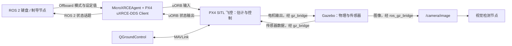

# FPV-Intercept
### 基于视觉伺服的自主拦截无人机系统（PX4 / ROS 2）

<div align="center">


</div>

<div align="center">


</div>

## 项目来源与原作者说明

本项目基于 [Eaglewzw（Verse）](https://github.com/Eaglewzw) 的
[Autonomous-Intercept-Drone](https://github.com/Eaglewzw/Autonomous-Intercept-Drone)
进行本机环境适配与修改，感谢原作者及贡献者的项目实现与资料分享。
以下引用原项目 README 中的说明：

> 本项目是一个面向自主无人机拦截任务的实验验证平台，集成了视觉感知、目标检测、比例导引（PNG）算法及飞行控制方法。该项目旨在为无人机自主拦截、制导算法研究及视觉伺服控制提供一套完整的仿真参考方案，适用于学习与学术研究。
>
> —— [原作者项目说明（中文 README）](https://github.com/Eaglewzw/Autonomous-Intercept-Drone/blob/main/README.zh-CN.md)

本文中的原项目介绍、算法说明及演示资料引用自上游仓库；本机安装配置、
PX4 / ROS 2 接口适配、一键启动与就绪检查等内容为当前版本的补充。

---

## 项目简介

当前仓库目录为 `FPV-gazebo_sim/`（原项目名 FPV-Intercept），对应 PX4 / ROS 2 视觉制导与仿真工作空间。
同级目录 [End2End-FPVIntercept](../End2End-FPVIntercept/README.zh-CN.md)
提供 Python 策略训练与端到端视觉拦截实验，具体训练及模型接口以该项目说明为准。

该系统在 ROS 2 环境下开发，结合 PX4 固件与 Gazebo 仿真器，实现了从目标发现到仿真拦截的全链路闭环。主要功能包括：

*   **视觉目标检测**：利用训练的 YOLO 模型和跟踪模型（LightTrack）实时识别并跟踪视场内的无人机目标。
*   **比例导引制导**：基于比例导引律（Proportional Navigation Guidance, PNG）生成拦截轨迹，实现对动态目标的精确前置拦截。
*   **仿真验证体系**：基于 PX4 软件在环（SITL）搭建，支持在 Gazebo 环境中进行算法的离线验证与参数调优。
*   **数据分析工具**：内置运动学与视觉指标记录脚本，用于定量评估制导律精度与视觉追踪稳定性。

---

阅读入口：

- [安装与编译](#快速上手)
- [键盘启动和按键说明](#keyboard-control)
- [仿真环境组成与 PX4-Autopilot 目录](#simulation-architecture)
- [无人机使用的控制器](#flight-controller)
- [数据话题、订阅示例和 ROS 2 控制接口](#vehicle-data)
- [中文官方文档学习路线](#official-docs)

## 快速上手

### 1. 环境依赖
*   **ROS 2 Version**: Humble
*   **Gazebo**:Gazebo Harmonic（gz-sim 8.12.0）
*   **PX4 Firmware**: v1.16 (**Micro-XRCE-DDS-Agent**版本推荐v2.4.x)
*   **地面站**: QGroundControl 5.0.8（支持 Ubuntu 22.04），运行期间保持连接
*   **Dependencies**: OpenCV, onnx, colcon

### 2. 编译项目
```bash
# 在本仓库根目录（即工作空间）编译
source /opt/ros/humble/setup.bash
colcon build --symlink-install
source install/setup.bash
```

<a id="keyboard-control"></a>

### 3. 使用 uav_keyboard_control 键盘控制无人机

该包的可执行文件是 `uav_keyboard_control`，ROS 节点名是
`/drone_keyboard_control`，实现见 [uav_keyboard_control/src/main.cpp](uav_keyboard_control/src/main.cpp)。
它通过 PX4 **Offboard 位置控制**操作第一架飞机 `/px4_1`，默认不控制 `/px4_2`。

#### 启动顺序

先完成 PX4、Gazebo、ROS 2 Humble 和 MicroXRCEAgent 的安装。若只想编译键盘节点及其工作空间依赖，可在本仓库根目录执行下面的命令；无需编译视觉/RL 包或加载 ONNX 模型。
这一步仅编译 ROS 包，不能替代 PX4 和仿真依赖的安装。

```bash
cd /home/ake/SJTU/graduation-project/FPV-gazebo_sim
source /opt/ros/humble/setup.bash
colcon build --symlink-install
source install/setup.bash
ros2 pkg executables uav_keyboard_control
```

1. **终端 1：只启动仿真底座。** `setup_workspace.sh` 已复制资源；若尚未复制，先执行
   下列两个 `cp`。修改本仓库的脚本或世界文件后，也要重新复制。

   ```bash
   cd /home/ake/SJTU/graduation-project/FPV-gazebo_sim
   cp ./run_swarm.sh ~/PX4-Autopilot/run_swarm.sh
   cp ./assets/gazebo_world/grass_world.sdf ~/PX4-Autopilot/Tools/simulation/gz/worlds/
   cd ~/PX4-Autopilot
   bash ./run_swarm.sh
   ```

   等待脚本提示全部就绪，保持这个终端运行。脚本会生成两架飞机，第二架可以留在地面。
   **此处不要运行 `./start.sh`**，因为它还会启动目标运动、检测及 RL 自动制导，
   与键盘节点同时向第一架飞机发送控制指令。

2. **终端 2：启动 QGroundControl。** 等待地面站显示两架飞机连接，并检查预飞提示。

   ```bash
   ~/Applications/QGroundControl-v5.0.8-x86_64.AppImage
   ```

3. **终端 3：启动键盘节点。** 保持该终端获得键盘焦点，使用小写字母，无需按回车。
   应在真实交互终端运行，不要把标准输入重定向到文件或后台运行。

   ```bash
   cd /home/ake/SJTU/graduation-project/FPV-gazebo_sim
   ros2 run uav_keyboard_control uav_keyboard_control
   ```

   节点启动后立即持续请求 **进入 Offboard 和解锁**，同时发送位置目标
   `(x, y, z) = (0, 0, -5)`、偏航角 `yaw = -3.14 rad`。
   请求被 PX4 接受后，飞机会自动飞向本地原点上方约 5 m 的位置，无需另按起飞键。
   日志 `Arm command send` 只表示发送了请求，是否成功需查看地面站或状态话题。

#### 按键含义：以当前源码和 NED 坐标为准

位置指令采用 PX4 本地 **NED** 坐标：`x` 向北、`y` 向东、`z` 向下，单位为米。
这些方向相对于本地世界坐标，而不是机头或 Gazebo 观察相机的方向。
每读取一次按键，目标位置对应分量变化 **0.1 m**：

- `w`：`x += 0.1`，向北移动目标点；同时将目标偏航设为 `-3.14 rad`。
- `s`：`x -= 0.1`，向南移动目标点；同时将目标偏航设为 `-3.14 rad`。
- `a`：`y += 0.1`，向东移动目标点。
- `d`：`y -= 0.1`，向西移动目标点。
- `q`：`z += 0.1`，目标点**下降** 0.1 m。
- `e`：`z -= 0.1`，目标点**上升** 0.1 m。

**源码中 `q/e` 的 `Moving Up/Down` 日志与实际升降相反，以上按坐标值解释。**
默认 `yaw ≈ -π` 时机头朝南，因此日志中的 Forward/Left 也不能作为机体方向解释。
例如，从初始设定值连续按 10 次 `w`，目标变为 `(1, 0, -5)`；再按 5 次 `e`，
目标变为 `(1, 0, -5.5)`。长按依赖操作系统的按键重复；松开后继续保持最后目标点。
当前节点没有独立的偏航调节键、暂停键或自动降落键。

#### 退出与当前实现限制

- `x` 只退出键盘读取循环，**后台线程仍会发送 Offboard、解锁和位置指令**，不能用它结束控制。
  结束试验使用键盘终端的 `Ctrl+C`，确认进程退出；若终端回显异常，可执行 `stty sane`。
  节点没有完善的线程退出清理，退出时可能出现 `terminate` 报错。
- 停止节点不会发送降落指令。停止后 PX4 会按 Offboard 丢失保护参数处理；需要降落时，
  停止键盘节点后通过 QGroundControl 对应飞机选择降落。也可以在仿真终端按 `Ctrl+C`
  结束整个场景，下一次启动重新试验。持续运行键盘节点时，它会反复请求 Offboard 和解锁。
- 当前控制循环实际写的是 `sleep_for(microseconds(10))`，不是注释中的 100 ms，
  会高频发送控制和解锁请求；它是一个基础示例，尚未实现按状态确认后停止重发的状态机。
- 当前状态订阅仍使用旧话题 `/px4_1/fmu/out/vehicle_status` 和默认可靠 QoS，
  且构造函数被键盘循环阻塞，正常键盘操作期间尚未进入 `rclcpp::spin()`。
  因此不要依赖它的状态回调判断是否解锁；本机 PX4 v1.16 的实际状态话题是
  `/px4_1/fmu/out/vehicle_status_v1`，可用下面的命令独立确认。
- 同一架飞机一次只运行一个控制节点。不要与 `uav_vehicle_controller`、
  `uav_png_intercept`、`uav_vision_png`、`uav_rl_guidance` 或 `uav_ibvs_control` 同时控制 `/px4_1`。
  其中 `uav_vehicle_controller` 是另一个速度控制示例，与此包的位置控制按键含义不同。

```bash
# 另开终端，在本仓库根目录 source ./env.sh 后执行。
ros2 topic echo /px4_1/fmu/out/vehicle_status_v1 \
  px4_msgs/msg/VehicleStatus --qos-reliability best_effort --once
ros2 topic echo /px4_1/fmu/out/vehicle_local_position \
  px4_msgs/msg/VehicleLocalPosition --qos-reliability best_effort --once
```

解锁状态应为 `arming_state: 2`（`ARMING_STATE_ARMED`），Offboard 应为
`nav_state: 14`（`NAVIGATION_STATE_OFFBOARD`）。若未起飞，先检查 QGC 连接、预飞错误、
本地位置/速度的有效标志，以及 `~/PX4-Autopilot/drone1.log`，不要只看节点的发送日志。


0. **启动仿真环境**:
   启动前，需将本仓库的仿真资源复制到 PX4-Autopilot 目录下：

   ```bash
   # 步骤1: 将本仓库的 run_swarm.sh 复制到 PX4-Autopilot 根目录（若尚未复制）
   cp ./run_swarm.sh ~/PX4-Autopilot/

   # 步骤2: 将自定义世界文件复制到 PX4 Gazebo 世界目录
   cp ./assets/gazebo_world/grass_world.sdf ~/PX4-Autopilot/Tools/simulation/gz/worlds/
   ```

   > 以上步骤只需执行一次。之后每次启动仿真，直接进入 PX4-Autopilot 目录运行启动脚本即可：
   ```bash
   cd ~/PX4-Autopilot
   ./run_swarm.sh
   ```

   该脚本会自动启动 Gazebo 仿真服务器、两架无人机（px4_1 拦截机 + px4_2 目标机）、MicroXRCEAgent 以及相机话题桥接。

   **启动目标节点前，打开 QGroundControl 并等待两架飞机通过 UDP 14550 自动连接。**
   本机安装位置为：

   ```bash
   ~/Applications/QGroundControl-v5.0.8-x86_64.AppImage
   ```

   Ubuntu 22.04 使用 [QGroundControl 5.0 系列](https://docs.qgroundcontrol.com/Stable_V5.0/en/qgc-user-guide/getting_started/download_and_install.html)。
   当前 PX4 配置要求地面站连接；否则 `drone2.log` 会报告
   `Preflight Fail: No connection to the ground control station` 并拒绝解锁。
   `Arm command sent` 仅表示目标节点发送了请求。目标节点仅请求一次解锁，
   若连接地面站前已经启动过该节点，连接成功后应在该节点终端按 Ctrl+C 并重新运行。


1. **启动目标机仿真**:
   ```bash
   # 默认圆周运动
   ros2 run uav_target_sim uav_target_sim

   # 或通过参数选择运动模式和活动范围
   ros2 run uav_target_sim uav_target_sim --ros-args -p motion_mode:=sinusoidal -p max_range:=10.0

   # 也可使用 launch 文件
   ros2 launch uav_target_sim target_sim.launch.py motion_mode:=random_walk
   ```

   **支持的目标运动模式**：

   | 参数值 | 运动模式 | 运动学公式 | 特点 |
   | :--- | :--- | :--- | :--- |
   | `circle` | 匀速圆周 | R=5m, w=0.5rad/s | 默认模式，半径5m匀速圆周运动 |
   | `sinusoidal` | 正弦机动 | a=0.5*sin(0.5t) m/s<sup>2</sup> | 前向匀速1m/s + 侧向正弦加速度，周期性规避 |
   | `random_walk` | 随机游走 | v(t+dt) = v(t) + N(0, 0.2) | 速度随机扰动，限速3m/s，无规律逃逸 |

   > `max_range` 参数（默认10m）控制目标活动范围，防止目标飞出拦截机视野。

2. **启动视觉制导拦截**:
   ```bash
   # 推荐直接运行（使用 .hpp 中的默认参数）
   ros2 run uav_vision_png uav_vision_png

   # 或通过 launch 文件加载 config/params.yaml 中的参数
   ros2 launch uav_vision_png vision_png.launch.py
   ```

   > **参数配置说明**：`uav_vision_png` 节点的参数优先级为：
   >   **launch 命令行 > params.yaml > .hpp 成员初始值**
   >
   > - 使用 `ros2 run` 直接启动：参数取 `.hpp` 中的默认值，**`params.yaml` 不会自动加载**，需手动传参 `--ros-args -p 参数名:=值`
   > - 使用 `ros2 launch` 启动：launch 文件自动加载 `config/params.yaml`，YAML 中的值会覆盖 `.hpp` 默认值
   > - 调试时可用 `ros2 param get /uav_vision_png <参数名>` 查看当前实际生效的值
   > - 可调参数详见 `uav_vision_png/config/params.yaml`，含 PNG 增益、视场补偿、起飞高度等

2-备. **启动 RL 学习制导拦截 (替代方案)** 🆕:
   `uav_rl_guidance` 是基于强化学习（BC + PPO）训练的 GRU 策略制导节点，用于取代传统 PNG 算法。
   它与 `uav_vision_png` 保持相同的话题接口、状态机和 CSV 统计格式，可无缝替换。
   使用 ONNX Runtime 推理，零 PyTorch 依赖，纯 C++ 实现。

   ```bash
   # 方式1：launch 启动（自动加载 config/params.yaml）
   ros2 launch uav_rl_guidance rl_guidance.launch.py

   # 方式2：直接运行（使用代码默认参数）
   ros2 run uav_rl_guidance uav_rl_guidance

   # A/B 基线模式：全程使用内置 PNG，不加载策略模型（与 uav_vision_png 等价）
   ros2 launch uav_rl_guidance rl_guidance.launch.py fallback_png:=true

   # 台架调试：跳过起飞，直接进入 SEARCHING
   ros2 launch uav_rl_guidance rl_guidance.launch.py bench_test:=true
   ```

   > **架构说明**：RL 策略在 INTERCEPT 阶段输出速度指令；若策略出现异常（watchdog），自动回退到内置 PNG 控制器。
   > 策略模型（ONNX `.onnx`）存放在 `uav_rl_guidance/models/` 下，
   > 配套训练项目见同级目录 [End2End-FPVIntercept](../End2End-FPVIntercept/README.zh-CN.md)
   > （上游项目为 [AeroIntercept](https://github.com/Eaglewzw/AeroIntercept)）。
   > 当前节点使用 15 维观测的 GRU 策略，更新兼容的 `uav_rl_guidance/models/policy.pt` 后，
   > 在本仓库根目录执行 `python3 uav_rl_guidance/src/export_onnx.py`；端到端图像策略需使用其对应的部署接口。

3. **启动视觉检测**:
   ```bash
   ros2 run uav_vision_dectect uav_vision_dectect
   ```

<a id="simulation-architecture"></a>

## 仿真环境是如何搭建起来的

本项目采用 **SITL（Software In The Loop，软件在环）**：在电脑上运行 PX4 飞控程序，
由 Gazebo 提供虚拟飞机、物理运动和传感器。本仓库提供外部 ROS 2 算法节点与启动脚本。
环境中的各部分分工如下：

- **Gazebo Harmonic**：加载 [grass_world.sdf](assets/gazebo_world/grass_world.sdf)，
  模拟重力、碰撞、电机及 IMU、气压计、磁力计、GPS、相机等传感器。
- **PX4-Autopilot v1.16.0**：每架飞机对应一个 PX4 SITL 进程，负责状态估计、
  解锁/模式管理、飞行控制和失联保护，通过 PX4 自带的 `gz_bridge` 与 Gazebo 交互。
- **MicroXRCEAgent v2.4.3**：本机监听 UDP 8888，与 PX4 内的 `uxrce_dds_client`
  通信，将选定的 PX4 uORB 消息接入 ROS 2 DDS，供节点订阅或发布。
- **ros_gz_bridge**：单独把 Gazebo 相机图像映射为 ROS 2 的 `/camera/image`。
  飞机状态和控制指令走上面的 DDS 链路。
- **本仓库 ROS 2 节点**：键盘节点发送位置目标；目标机节点生成运动轨迹；
  PNG、视觉制导或 RL 节点生成外部制导指令。
- **QGroundControl**：经 MAVLink/UDP 14550 连接两台 PX4，用来查看状态、参数和下发地面站命令。
  它与 ROS 2 DDS 是两条通信链路；当前配置要求地面站连接后才能正常解锁。



安装与启动在代码中分为三个阶段：

1. [install_system_dependencies.sh](scripts/install_system_dependencies.sh) 安装系统编译依赖、
   Gazebo Harmonic、适配 Humble 的 `ros_gzharmonic` 和视觉推理库。
   脚本假定已有 `/opt/ros/humble`；它会替换旧 Gazebo/ros_gz 包，全量视觉环境还需满足
   ONNX Runtime 的 CUDA 运行库依赖。
2. [setup_workspace.sh](scripts/setup_workspace.sh) 下载固定版本的 PX4 及子模块、
   编译安装 Agent、编译本工作空间的消息和算法节点、复制世界/启动脚本，
   为 DDS 增加 `hover_thrust_estimate` 导出，最后构建 `px4_sitl_default`。
3. [run_swarm.sh](run_swarm.sh) 启动 Agent，再启动带相机的 PX4 实例 1：
   `PX4_SYS_AUTOSTART=4002`、`PX4_SIM_MODEL=gz_x500_depth`、`px4 -i 1`，
   由它启动 `grass_world`；相机就绪后，再启动普通 x500 的实例 2：
   `PX4_SYS_AUTOSTART=4001`、`PX4_SIM_MODEL=gz_x500`、`px4 -i 2`。
   第二个实例设置 `PX4_GZ_STANDALONE=1`，连接同一个 Gazebo 世界。

脚本实际设置的 Gazebo 初始位置是第一架 `PX4_GZ_MODEL_POSE="0,0"`，
第二架 `"20,0"`（Gazebo 世界的 x、y，单位 m）；脚本末尾摘要中的第二架 `(0,20)`
与设置不一致，应以启动命令为准。这些生成位置不能直接当作各自 PX4 本地 NED 位置。
新 Gazebo 的启动参数及多机方式可对照官方
[Gazebo 仿真](https://docs.px4.io/v1.16/zh/sim_gazebo_gz/)和
[多机仿真](https://docs.px4.io/v1.16/zh/sim_gazebo_gz/multi_vehicle_simulation)。

### PX4-Autopilot 文件夹是什么，为什么要在里面启动

`~/PX4-Autopilot` 是官方 [PX4/PX4-Autopilot](https://github.com/PX4/PX4-Autopilot/tree/v1.16.0)
飞控源码仓库。本项目使用其中的 Linux SITL 构建；同一源码体系也能为真实飞控板编译固件。
它与当前 ROS 2 工作空间是两个独立目录：

- 本仓库：`uav_*` 为外部节点，`px4_msgs/msg/` 为 ROS 2 消息定义；
  `build/`、`install/`、`log/` 是 colcon 产物。`px4_msgs` 本身不运行飞控。
- `~/PX4-Autopilot/build/px4_sitl_default/bin/px4`：编译得到的飞控可执行程序。
- `~/PX4-Autopilot/ROMFS/px4fmu_common/`：启动脚本和机型配置，包含 4001/4002 对应的 x500 配置。
- `~/PX4-Autopilot/Tools/simulation/gz/`：Gazebo 模型、世界与配套资源。
- `~/PX4-Autopilot/src/modules/`：状态估计器、控制器、DDS 客户端等飞控模块源码。

**必须切换目录是当前 `run_swarm.sh` 的相对路径要求。** 它检查并执行
`./build/px4_sitl_default/bin/px4`，日志也写在当前目录，所以只写
`bash ~/PX4-Autopilot/run_swarm.sh` 并不会自动改变工作目录。
在已加载 `env.sh` 的终端，可以从任意目录这样启动：

```bash
(cd ~/PX4-Autopilot && bash ./run_swarm.sh)
```

ROS 2 节点可在任意已加载工作空间环境的终端运行，无需放进 PX4 目录。
本仓库的 `./start.sh` 已用 `env --chdir="$px4_dir"` 自动切换到 PX4 目录，
因此自动拦截可从本仓库根目录启动；该脚本包含自动控制节点，键盘试飞仍使用上面的手动流程。
官方常见命令 `make px4_sitl gz_x500` 是单机示例，本项目脚本则直接运行已构建好的两个实例。

<a id="flight-controller"></a>

## 仿真器中无人机的控制器是什么

让飞机稳定飞行的控制器运行在 **PX4 SITL** 中。键盘/PNG/RL 属于外部目标生成或制导层，
通过 Offboard 告诉 PX4 要飞到哪里、以什么速度飞；Gazebo 根据电机输出模拟飞机运动。

键盘位置控制对应的主链路是：

```text
键盘位置目标 TrajectorySetpoint
  → mc_pos_control：位置 P 控制 → 速度 PID 控制 → 推力与姿态目标
  → mc_att_control：基于四元数的姿态比例控制 → 角速度目标
  → mc_rate_control：角速度 PID 控制 → 力矩目标
  → control_allocator：把推力/力矩分配给各电机
  → Gazebo 电机与机体物理模型
```

反馈由 PX4 的 `ekf2` 等模块根据模拟传感器估计。发送速度设定值时可跳过位置环；
发送角速度/推力等更底层设定值时，所使用的控制环也会变化，取决于 `OffboardControlMode`
和消息内容。本仓库的 `uav_ibvs_control` 还发布 `VehicleRatesSetpoint`，
不能把所有节点都理解成同一种位置控制。

可从 `~/PX4-Autopilot/ROMFS/px4fmu_common/init.d/rc.mc_apps` 查看控制模块启动，
从 `src/modules/mc_pos_control/`、`mc_att_control/`、`mc_rate_control/`、
`control_allocator/`、`ekf2/` 阅读实现。控制参数可在 QGC 中查询，常见前缀包括
`MPC_*`、`MC_ROLL*`、`MC_PITCH*`、`MC_YAW*`、`CA_*`。
环路结构和参数作用见官方[控制器图解](https://docs.px4.io/v1.16/zh/flight_stack/controller_diagrams)。

<a id="vehicle-data"></a>

## 无人机数据在哪里发布，在哪里调用

### 数据从哪里来，哪些话题能读

PX4 的传感器/估计/状态模块先发布内部 **uORB** 消息，再由
`uxrce_dds_client → MicroXRCEAgent → ROS 2` 导出。`/fmu/out/` 表示从飞控输出，
`/fmu/in/` 表示送入飞控，方向以 PX4 为参照。导出清单位于：

```text
~/PX4-Autopilot/src/modules/uxrce_dds_client/dds_topics.yaml
```

其中 `publications` 是 PX4 向外发布，`subscriptions` 是 PX4 接收外部输入。
**`px4_msgs/msg/` 中有某个消息定义，不代表运行时一定发布该话题。**
新增 DDS 导出通常要修改该 YAML 并重新编译 PX4；已有消息还需确认实际产生了数据。
详细规则见官方 [uXRCE-DDS 桥接](https://docs.px4.io/v1.16/zh/middleware/uxrce_dds)。

本项目的实例 1/2 使用 `/px4_1`、`/px4_2` 命名空间。
默认 `MAV_SYS_ID` 分别为 **2/3**，`UXRCE_DDS_KEY` 也分别为 **2/3**；
系统 ID 用于命令目标，DDS key 用于区分客户端，它们用途不同。
PX4 v1.16 对非零消息版本添加话题后缀，本仓库 `VehicleStatus.MESSAGE_VERSION = 1`，
因此状态话题实际为 `vehicle_status_v1`，即使 YAML 条目仍写 `vehicle_status`。

常用输出如下；将 `/px4_1` 换成 `/px4_2` 可查看第二架飞机：

- `/px4_1/fmu/out/vehicle_local_position` → `px4_msgs/msg/VehicleLocalPosition`：
  本地 NED 位置 `x/y/z`、速度 `vx/vy/vz`、加速度、航向及位置/速度有效标志。
- `/px4_1/fmu/out/vehicle_odometry` → `px4_msgs/msg/VehicleOdometry`：
  `position`、姿态四元数 `q`（`w,x,y,z`）、`velocity`、机体角速度；
  读取时同时检查 `pose_frame`、`velocity_frame`，不要默认所有字段都在同一坐标系。
- `/px4_1/fmu/out/vehicle_attitude` → `px4_msgs/msg/VehicleAttitude`：姿态四元数。
- `/px4_1/fmu/out/vehicle_gps_position` → `px4_msgs/msg/SensorGps`：模拟 GPS 输出；
  `/px4_1/fmu/out/vehicle_global_position` → `px4_msgs/msg/VehicleGlobalPosition`：融合后的全局位置。
- `/px4_1/fmu/out/sensor_combined` → `px4_msgs/msg/SensorCombined`：组合后的陀螺仪/加速度计数据。
- `/px4_1/fmu/out/vehicle_status_v1` → `px4_msgs/msg/VehicleStatus`：解锁、导航模式、地面站连接等状态。
- `/px4_1/fmu/out/vehicle_command_ack` → `px4_msgs/msg/VehicleCommandAck`：命令是否接受及拒绝原因。
- `/px4_1/fmu/out/hover_thrust_estimate` → `px4_msgs/msg/HoverThrustEstimate`：悬停推力估计，
  本项目安装脚本额外启用，估计器运行后才有有效结果。
- `/camera/image` → `sensor_msgs/msg/Image`：第一架机的相机图像，由 `run_swarm.sh`
  将 Gazebo 的 `/world/grass_world/model/x500_depth_1/link/camera_link/sensor/IMX214/image`
  单向桥接出来。当前脚本没有额外桥接深度图或 `CameraInfo`。
- `/camera_detect_result` → `uav_common_msg/msg/RectMsg`：视觉节点运行后发布的检测框。
  它是算法输出；当前检测发布代码将 `depth` 固定为 0，不能把它当作测距数据。

PX4 本地位置是估计值，不是直接读取 Gazebo 真值。各机的本地原点可能不同，
双机位置比较应先统一参考系。使用 ROS 常见 ENU/FLU 数据时也要显式转换到 PX4 的 NED/FRD，
DDS 不会自动转换坐标。字段和单位以本仓库 `.msg` 及官方
[uORB 消息参考](https://docs.px4.io/v1.16/zh/msg_docs/)为准。

### 在终端查看和记录数据

在本仓库根目录加载环境，保持仿真运行：

```bash
source ./env.sh
ros2 topic list
ros2 topic info /px4_1/fmu/out/vehicle_odometry --verbose
ros2 interface show px4_msgs/msg/VehicleOdometry
ros2 topic echo /px4_1/fmu/out/vehicle_odometry \
  px4_msgs/msg/VehicleOdometry --qos-reliability best_effort --once
ros2 topic echo /px4_2/fmu/out/vehicle_local_position \
  px4_msgs/msg/VehicleLocalPosition --qos-reliability best_effort --once
ros2 topic hz /camera/image
```

订阅 PX4 输出使用 `best_effort`/传感器 QoS，避免出现“能看到话题却收不到消息”。
录制飞控状态可执行下列命令，按 `Ctrl+C` 结束；回放时也需加载同一工作空间的消息定义。

```bash
ros2 bag record /px4_1/fmu/out/vehicle_odometry \
  /px4_1/fmu/out/vehicle_local_position /px4_1/fmu/out/vehicle_status_v1
```

### 仓库代码在哪里调用这些数据

- [uav_vision_png/src/vision_png_control.cpp](uav_vision_png/src/vision_png_control.cpp)：
  构造函数订阅里程计、位置、状态、GPS、悬停推力和检测结果，在回调中更新内部状态。
- [uav_rl_guidance/src/rl_guidance_node.cpp](uav_rl_guidance/src/rl_guidance_node.cpp)：
  订阅同类飞行/视觉数据，构建策略观测并发布制导设定值。
- [uav_target_sim/src/uav_target_sim.cpp](uav_target_sim/src/uav_target_sim.cpp)：
  订阅目标机 GPS，并向 `/px4_2/fmu/in/*` 发送轨迹和命令。
- [uav_vehicle_controller.cpp](uav_vehicle_controller/include/uav_vehicle_controller/uav_vehicle_controller.cpp)：
  `vehicle_odometry_callback()` 将里程计四元数转为欧拉角。
- [uav_topic_subscrib.cpp](uav_vision_dectect/src/uav_topic_subscrib.cpp)：
  订阅 `/camera/image`，发布 `/camera_detect_result`；当前 `main.cpp` 中飞行控制类的实例化已注释。
- [recorder_node.py](uav_bc_recorder/uav_bc_recorder/recorder_node.py)：
  订阅图像、里程计、位置、GPS 和设定值，作为 Python 数据采集参考。

例如，在已加载环境的终端直接运行下面的 Python ROS 2 节点，即可每秒打印一次有效的本地位置。
它只订阅数据，按 `Ctrl+C` 退出：

```bash
python3 - <<'PY'
import rclpy
from rclpy.node import Node
from rclpy.qos import qos_profile_sensor_data
from px4_msgs.msg import VehicleLocalPosition

class PositionReader(Node):
    def __init__(self):
        super().__init__('position_reader')
        self.latest = None
        self.sub = self.create_subscription(
            VehicleLocalPosition, '/px4_1/fmu/out/vehicle_local_position',
            self.on_position, qos_profile_sensor_data)
        self.timer = self.create_timer(1.0, self.report)

    def on_position(self, msg):
        self.latest = msg

    def report(self):
        msg = self.latest
        if msg is not None and msg.xy_valid and msg.z_valid:
            self.get_logger().info(
                f'NED: x={msg.x:.2f}, y={msg.y:.2f}, z={msg.z:.2f} m')

rclpy.init()
node = PositionReader()
try:
    rclpy.spin(node)
except KeyboardInterrupt:
    pass
finally:
    node.destroy_node()
    if rclpy.ok():
        rclpy.shutdown()
PY
```

### 能否用自己写的 ROS 节点控制

**可以，仓库里的键盘、目标机和制导程序本身就是 ROS 2 控制节点。**
当前使用 `px4_msgs + uXRCE-DDS`，无需再启动 MAVROS；也没有默认接收 `/cmd_vel` 的转换节点。
自己的 C++/Python 节点可订阅上述状态，再发布以下输入：

- `/px4_1/fmu/in/offboard_control_mode`（`OffboardControlMode`）：选择位置、速度、姿态等控制层级，
  持续提供外部控制心跳。
- `/px4_1/fmu/in/trajectory_setpoint`（`TrajectorySetpoint`）：发送本地 NED 位置/速度/加速度与偏航目标。
  例如位置模式使用 `position=true`；纯速度模式使用 `position=false, velocity=true`，
  并将 `TrajectorySetpoint.position` 的三个分量设为 `NaN`，避免仍被位置目标接管。
  其他不使用的设定值也按接口语义设为 `NaN`，不能把全零初始化理解为“忽略该字段”。
- `/px4_1/fmu/in/vehicle_command`（`VehicleCommand`）：请求切换 Offboard、解锁、降落等动作，
  并订阅 `vehicle_command_ack` 和状态消息确认结果。

节点应使用定时器持续发送心跳和设定值（例如 10–50 Hz），在请求 Offboard/解锁前先提供
超过 1 秒的心跳；PX4 要求心跳频率高于 2 Hz，并要求对应层级的状态估计有效。
心跳停止后会触发 `COM_OF_LOSS_T` 等参数规定的保护行为。消息 `timestamp` 使用微秒，
本仓库 C++ 发布代码采用 `now().nanoseconds() / 1000`。模式和坐标要求见官方
[Offboard 模式](https://docs.px4.io/v1.16/zh/flight_modes/offboard)及
[ROS 2 Offboard 示例](https://docs.px4.io/v1.16/zh/ros2/offboard_control)。

本配置下第一架 `VehicleCommand.target_system=2`，第二架为 `3`，
`target_component=1`、`from_external=true`。想控制第二架时，需同时修改/重映射输入话题和
命令目标 ID；仅把 `/px4_1` 改为 `/px4_2` 不足以改变代码中写死的 `target_system`。
多个控制节点不要同时发布同一架飞机的设定值。

<a id="official-docs"></a>

## 中文官方文档学习路线

本环境固定使用 PX4 v1.16.0，建议先读 **v1.16 中文站**，避免照搬 `main` 或其他版本的
话题名、Gazebo Classic/MAVROS 教程。下列均为 PX4 官方文档的中文入口；部分章节翻译尚不完整，
页面可能包含英文，遇到差异时结合本地 v1.16 源码核对。

1. [PX4 v1.16 中文用户指南](https://docs.px4.io/v1.16/zh/)：先了解飞控、地面站、解锁和飞行模式。
2. [Ubuntu 开发环境](https://docs.px4.io/v1.16/zh/dev_setup/dev_env_linux_ubuntu)：理解下载源码、
   安装工具链和构建 PX4 的过程；本仓库依赖组合以自己的安装脚本为准。
3. [Gazebo 仿真](https://docs.px4.io/v1.16/zh/sim_gazebo_gz/)与
   [Gazebo 多机仿真](https://docs.px4.io/v1.16/zh/sim_gazebo_gz/multi_vehicle_simulation)：
   对照 `run_swarm.sh` 学习机型、世界、实例编号和生成位置。
4. [ROS 2 用户指南](https://docs.px4.io/v1.16/zh/ros2/user_guide)与
   [uXRCE-DDS 桥接](https://docs.px4.io/v1.16/zh/middleware/uxrce_dds)：
   学习消息版本匹配、QoS、命名空间和 `dds_topics.yaml`。
5. [Offboard 模式](https://docs.px4.io/v1.16/zh/flight_modes/offboard)与
   [ROS 2 Offboard 控制示例](https://docs.px4.io/v1.16/zh/ros2/offboard_control)：
   对照键盘节点学习心跳、设定值、切换模式及解锁流程。
6. [控制器图解](https://docs.px4.io/v1.16/zh/flight_stack/controller_diagrams)与
   [uORB 消息参考](https://docs.px4.io/v1.16/zh/msg_docs/)：继续阅读位置/速度/姿态控制环和具体数据字段。

建议第一次实践按“启动仿真 → 读取状态 → 键盘位置控制 → 自己编写 ROS 2 订阅/控制节点”的顺序进行，
再加入视觉检测、PNG 或 RL 制导。
---

---

> **项目维护者注**：如果您需要更多关于算法推导（PNG）的细节，请参考各功能包下的 `include/` 头文件或联系开发团队。
